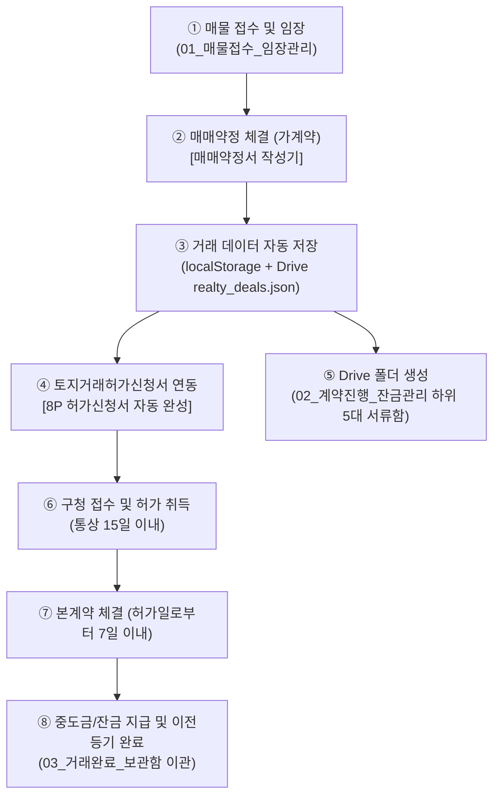

# 부동산이즈 두산공인중개사사무소 업무 통합 관리 시스템 사용설명서

본 시스템은 **Google Drive 클라우드 기반 서류·폴더 통합 관리**, **엑셀 서식 1:1 대응 매매약정서(가계약) 작성**, 그리고 **국토교통부 표준 토지거래계약 허가신청서(8P) 자동 완성**을 하나로 연결한 원스톱 공인중개사 실무 솔루션입니다.

---

## 📌 목차
1. [시스템 아키텍처 및 업무 흐름 (Overview)](#1-시스템-아키텍처-및-업무-흐름-overview)
2. [모듈 1: 서류·폴더 통합 관리소 (index.html)](#2-모듈-1-서류폴더-통합-관리소-indexhtml)
3. [모듈 2: 매매약정서(가계약) 작성기 (agreement/index.html)](#3-모듈-2-매매약정서가계약-작성기-agreementindexhtml)
4. [모듈 3: 토지거래계약 허가신청서 작성기 (toji-permit/index.html)](#4-모듈-3-토지거래계약-허가신청서-작성기-toji-permitindexhtml)
5. [데이터 저장 체계 및 클라우드 동기화](#5-데이터-저장-체계-및-클라우드-동기화)
6. [실무 꿀팁 및 인쇄 가이드 (FAQ)](#6-실무-꿀팁-및-인쇄-가이드-faq)

---

## 1. 시스템 아키텍처 및 업무 흐름 (Overview)

### 🔄 원스톱 3단계 업무 프로세스
1. **약정서 작성**: 매매약정서 화면에서 단지 원클릭 선택 후 당사자 및 대금 정보를 입력하고 인쇄합니다.
2. **허가신청서 연동**: 약정서 하단 `[토지거래허가신청서 8P 작성하기]` 버튼을 누르면 모든 데이터가 허가신청서에 즉시 반영됩니다.
3. **구글 드라이브 서류함 자동 생성**: 메인 화면 거래 카드에서 `[📁 Drive 폴더 생성]`을 누르면 `02_계약진행_잔금관리` 하위에 거래명 폴더와 표준 5대 서류함이 자동 생성되어 서류를 즉시 드래그하여 보관할 수 있습니다.

---

## 2. 모듈 1: 서류·폴더 통합 관리소 (`index.html`)

메인 화면은 구글 드라이브와 직접 통신하여 공인중개사 사무소의 모든 고객 서류와 계약 폴더를 실시간으로 관리하는 관제 센터입니다.

### 2.1 Google Drive 로그인 및 작업 폴더 설정
* 우측 상단 **[Google Drive 로그인 연결]** 버튼을 클릭하여 본인 구글 계정을 승인합니다.
* 승인 완료 시 상단 배지에 `● Google Drive 직접 연결됨 (부동산업무)`으로 전환됩니다.
* 별도의 백엔드 서버 없이 브라우저에서 Google Drive API v3를 직접 호출하므로 고객의 신분증이나 계약서류가 외부 서버로 유출되지 않습니다.

### 2.2 표준 7대 루트 폴더 체계
시스템 최초 실행 시 다음 7대 표준 폴더가 구글 드라이브에 자동으로 정돈됩니다:
* `00_공통서식_마스터`: 표준 계약서 양식, 설명서, 위임장, 세무 서식 등
* `01_매물접수_임장관리`: 신규 접수된 물건 및 임장 사진, 가계약 이전 매물 보관
* `02_계약진행_잔금관리`: **가계약(약정), 허가신청, 본계약 체결 및 잔금 대기 물건**
* `03_거래완료_보관함`: 잔금 지급 및 이전등기가 완료된 계약 (연도별 보관)
* `04_대출상담_금융서류`: 고객 주택담보대출, 자금조달 증빙 서류
* `05_사무소행정_세무`: 사업자등록증, 공제증서, 세금계산서, 영수증
* `06_홍보_마케팅`: 블로그 포스팅 원고, 단지 사진, 매물 브리핑 자료

### 2.3 새 폴더 마법사 (`+ 새 폴더 마법사`)
* 상단 마법사 버튼을 누르면 날짜, 단지명, 동호수, 거래유형(매매/전세/월세)을 조합하여 일관된 명명 규칙으로 폴더를 생성합니다.
* 예: `20261125_목련두산6단지_601동 101호_매매`

### 2.4 원스톱 거래 데이터 관리소 (약정서 & 허가신청서 동기화)
상단 액션바의 **[📋 거래목록]** 버튼을 누르면 팝업 모달이 실행됩니다:
1. **거래 라이프사이클 관리**:
   * 각 거래의 진행 상태를 `가계약 체결` ➔ `허가신청 접수` ➔ `허가완료(D-7)` ➔ `본계약 체결` ➔ `잔금완료`로 변경할 수 있습니다.
2. **Drive 폴더 생성**:
   * 각 거래 카드의 **[📁 Drive 폴더 생성]** 버튼을 클릭하면:
   * `02_계약진행_잔금관리` 하위에 거래명 폴더와 **표준 5대 서류함**이 즉시 생성됩니다:
     1. `01_공적장부_발급본`
     2. `02_신분증_위임_자격서류`
     3. `03_계약서_확인설명서` (**매매약정서** 보관)
     4. `04_신고필증_확정일자` (토지거래허가신청서·허가증 보관)
     5. `05_영수증_정산내역` (약정금 및 중개보수 영수증 보관)
3. **클라우드 백업 및 동기화**:
   * **[☁️ Google Drive 동기화]**: 거래 목록 전체를 구글 드라이브의 `realty_deals.json` 파일과 실시간 머지 및 업로드합니다.
   * **[전체 백업 JSON] / [JSON 복원]**: PC 로컬 파일로 거래 목록을 안전하게 백업하거나 다른 컴퓨터로 불러옵니다.

### 2.5 스마트 서류 등록 및 필수 서류 체크리스트
* 대용량 PDF나 사진 파일을 화면 테이블 위로 드래그하면 즉시 구글 드라이브 해당 폴더에 업로드됩니다.
* 파일명에 따라 카테고리 뱃지가 자동 부여됩니다 (`공적장부`, `신분·자격`, `계약서류`, `신고·필증`, `정산·영수`).
* 상단 **필수 서류 체크리스트 Bar**에서 6대 필수 서류(등기부, 건축물대장, 신분증, 계약서·약정서, 확인설명서, 신고·허가필증) 구비 여부가 실시간 확인됩니다.

### 2.6 단계 이동 원클릭 기능
* `01_매물접수` 단계에서 가계약 성사 시 상단 `[계약성사 ➔ 02_계약진행으로 이동]` 클릭
* `02_계약진행` 단계에서 잔금 완료 시 `[잔금완료 ➔ 03_거래완료 보관함 이관]` 클릭 시 자동으로 폴더가 이동되며 날짜 접두어(`YYYYMMDD완료_`)가 자동 부여됩니다.

---

## 3. 모듈 2: 매매약정서(가계약) 작성기 (`agreement/index.html`)

기존 엑셀 매매약정서 양식의 레이아웃과 수식을 웹으로 100% 이식하여, 깔끔한 A4 2페이지 인쇄와 스마트 데이터 연동을 지원합니다.

### 3.1 주요 기능 및 입력 가이드
1. **평촌 주요단지 원클릭 선택 및 단지정보 관리**:
   * 목련두산 2단지, 목련우성 3단지, 목련선경 5단지, 목련두산 6단지 등 버튼 1클릭으로 토지소재지, 지번, 대지권 분모, 건물구조 자동 입력
   * **[단지정보 관리/수정]** 창을 통해 단지 추가, 수정, 삭제, 순서 우선순위 지정 가능
   * 대지권 비율 표기는 자동완성 방식이며 분모/분자 공백 시 서식에 공백 처리
2. **동적 당사자 서식 (공동명의 지원)**:
   * 소유자(매도인) 및 매수약정인 각각 **[+ 공동명의 추가]** 체크 시에만 2행 템플릿으로 확장
   * 체크 해제 시 1인 서식으로 자동 복귀하여 빈칸 없는 미려한 서식 출력
3. **주민등록번호 뒷자리 마스킹 토글**:
   * `[생년월일만 표시]` 체크 시 뒷자리가 `●●●●●●●`로 안전하게 가려져 개인정보 보호
4. **금액 및 대금 지급일정 (콤마 자동 서식)**:
   * 매매대금, 약정금(1차/2차 분할 입금 및 날짜), 계약금, 중도금, 잔금 입력 시 3자리 콤마 자동 서식화
   * 한글 금액(예: 일십이억오천만원정) 자동 변환
5. **특약사항 원클릭 템플릿 (1~4번)**:
   * `권리하자없음 기본`, `임차인 승계 조건`, `토지거래허가 조건부 특약`, `주택담보대출 조건부 특약` 원클릭 적용 및 자유로운 편집
6. **2페이지 하단 영수증 자동 연동**:
   * 1차 약정금 입금 내역 및 당사자 날인 영수증이 2페이지 하단에 자동 정돈

### 3.2 토지거래허가신청서로 원클릭 이동
* 약정서 작성을 마치고 하단 **[토지거래허가신청서(8P) 작성하기]**를 클릭하면:
* 현재 거래 내용이 즉시 저장되고, 허가신청서 작성 페이지로 자동 이동하면서 모든 항목이 100% 일치되게 채워집니다.

---

## 4. 모듈 3: 토지거래계약 허가신청서 작성기 (`toji-permit/index.html`)

국토교통부 표준 법정 서식 8페이지를 완벽하게 재현한 전문 신청서 작성기입니다.

### 4.1 8페이지 서식 구성 및 세부 규칙

| 페이지 | 서식 명칭 | 주요 내용 및 자동 연동 규칙 |
| :--- | :--- | :--- |
| **1P** | **토지거래계약 허가신청서** | • **⑰ 정착물의 내용**: 1행 `단지명`, 2행 `동호수` 2줄 중앙 정렬 출력 • **⑯ 종류 (주용도)**: 기본값 `'공동주택(아파트)'` • **⑲ 권리 내용**: 기본값 `'이전'` • **⑳ 이전/설정 형태**: 기본값 `'매매'` • **계약예정금액**: ㉖단가, ㉗토지예정금액, ㉙정착물예정금액 공백 처리 / ㉘종류 `'공동주택'` / ㉚예정금액합계 정상 출력 |
| **2P** | **허가신청서 별지** | 공동 매도인 또는 공동 매수인 존재 시 명의자 2 상세 인적사항 및 지분(1/2) 자동 출력 |
| **3P** | **토지취득 자금조달계획서 (매수인 1)** | 자기자금(예금, 주식, 증여, 부동산), 차입금(금융기관 대출, 사채) 입력 시 3자리 콤마 자동 서식 및 합계 자동 연산 |
| **3-2P** | **토지취득 자금조달계획서 (매수인 2)** | 공동매수인 존재 시 자동 활성화되며 별도 자금조달계획 작성 지원 |
| **4P** | **토지이용계획서 (A)** | • **주거용** 취득 계획 • **잔금예정일과 등기신청일 기본 동일 날짜 연동** (수정 가능) • 임차인 퇴거 및 입주 일정 기재 • 실거주 전입유예 건일 경우 사이드바에 '등기신청일 확인' 알림 표시 |
| **5P** | **토지이용계획서 (B)** | • 실거주 유예 시 작성하는 서식 • **기본적으로 인쇄/서식 목록에서 제외**, 사이드바 `[5P 포함]` 체크 시에만 동적 포함 |
| **6P** | **주택 임대차 계약 확인서** | • 묵시적 갱신 등 확인 시 작성하는 서식 • **기본적으로 인쇄/서식 목록에서 제외**, 사이드바 `[6P 포함]` 체크 시에만 동적 포함 |
| **7P** | **개인정보 수집·이용 동의서 (1)** | 매수인 1 동의서 |
| **7-2P** | **개인정보 수집·이용 동의서 (2)** | 공동매수인 2 동의서 |
| **8P** | **토지거래계약 허가증** | 구청 교부용 표준 허가증 서식 (사전 시뮬레이션 및 데이터 보관용) |

### 4.2 시트 양방향 직접 편집 (Two-way Inline Sync)
* 좌측 입력 패널에서 값을 입력해도 시트에 반영되지만, **우측 실제 서식 시트의 글자를 직접 클릭하여 수정**해도 좌측 입력 패널과 데이터 저장소에 실시간 동기화됩니다.

### 4.3 표준 파일명 인쇄 및 PDF 저장
* **[인쇄 및 PDF 저장]** 클릭 시 브라우저 인쇄 창이 열리며, 파일명이 자동으로 **`YYYYMMDD_단지명_동호수_토지거래허가신청서.pdf`** 형식으로 자동 설정됩니다.

---

## 5. 데이터 저장 체계 및 클라우드 동기화

### 5.1 브라우저 로컬 스토리지 (`localStorage`)
* 모든 거래 데이터는 인터넷 연결 여부와 무관하게 브라우저 `localStorage`(`realty_deals`)에 영구 저장됩니다.
* 사무소 설정(`realty_agency_config`), 단지 프리셋(`realty_complex_presets`), 특약 템플릿(`realty_clause_templates`)도 분리 보관됩니다.

### 5.2 Google Drive 클라우드 동기화 (`realty_deals.json`)
* 메인 화면에서 구글 드라이브를 연결하면 작업 폴더(`부동산업무`)에 `realty_deals.json` 파일이 자동 생성되어 실시간 백업됩니다.
* 다른 PC나 노트북에서 동일한 구글 드라이브 계정으로 로그인하면 기존 거래 데이터가 그대로 복원됩니다.
* 실수로 삭제한 거래가 클라우드에서 다시 되살아나지 않도록 톰스톤(Tombstone) 삭제 추적 메커니즘이 적용되어 있습니다.

---

## 6. 실무 꿀팁 및 인쇄 가이드 (FAQ)

### Q1. 브라우저 인쇄 시 여백이나 잘림 현상이 발생하면 어떻게 하나요?
> [!TIP]
> 인쇄 미리보기 창(Ctrl + P)에서 다음 설정을 반드시 확인하세요:
> 1. **용지 크기**: `A4`
> 2. **여백**: `없음(None)` 또는 `기본(Default)`
> 3. **배율(Scale)**: `100%` (맞춤 선택 시 '100' 입력)
> 4. **옵션**: `배경 그래픽(Background graphics)` **체크 필수** (표 테두리와 음영을 선명하게 인쇄)

### Q2. 공동명의가 아닌 단독 명의일 때 2P, 3-2P, 7-2P는 어떻게 되나요?
> [!NOTE]
> 공동명의가 아닐 경우 별지 페이지들은 인쇄 목록에서 자동으로 제외되거나 불필요한 공란 출력이 방지됩니다. 5P, 6P 역시 기본값으로 제외되어 있으므로 평소 아파트 실거주 거래 시에는 필수 1P, 3P, 4P, 7P만 깔끔하게 출력됩니다.

### Q3. 다른 컴퓨터로 서류와 거래 데이터를 옮기려면 어떻게 하나요?
> [!NOTE]
> 1. 구글 드라이브 로그인을 유지하시는 경우, 새 컴퓨터에서 메인 화면 접속 후 **[Google Drive 로그인 연결]**만 누르면 모든 서류 폴더와 거래 데이터가 1초 만에 자동 동기화됩니다.
> 2. 오프라인 이동 시에는 거래 관리 모달에서 **[전체 백업 JSON]**을 받아 USB로 옮긴 후, 새 컴퓨터에서 **[JSON 복원]**을 누르시면 됩니다.

---
*시스템 관리 및 기술 문의: 부동산이즈 두산공인중개사사무소 시스템 자동화 팀*
